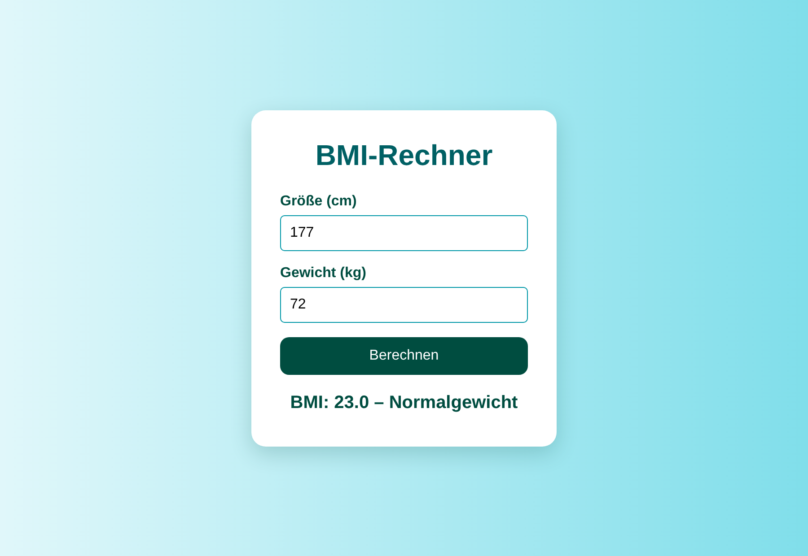

# BMI-Rechner

Ein kleiner Rechner für den Body-Mass-Index (BMI) mit HTML, CSS und JavaScript, ohne Frameworks oder Bibliotheken.
Man gibt Körpergröße und Gewicht ein und bekommt den BMI und die passende Gewichtskategorie angezeigt.



## Starten

Es ist keine Installation nötig. Repository herunterladen und `index.html` im Browser öffnen.

## Funktionen

- Berechnung des BMI aus Größe (cm) und Gewicht (kg)
- Einordnung in die sechs Kategorien der WHO
- Prüfung der Eingaben: leere Felder, Text und Werte ≤ 0 werden abgelehnt
- Bedienbar mit Maus, Tastatur (Enter) und auf dem Handy

## So funktioniert es

Die Formel lautet:

```
BMI = Gewicht in kg / (Größe in m)²
```

Beispiel: 72 kg bei 1,77 m ergibt 72 / (1,77 × 1,77) = 23,0.

| BMI            | Kategorie           |
|----------------|---------------------|
| unter 18,5     | Untergewicht        |
| 18,5 bis < 25  | Normalgewicht       |
| 25 bis < 30    | Übergewicht         |
| 30 bis < 35    | Adipositas Grad I   |
| 35 bis < 40    | Adipositas Grad II  |
| ab 40          | Adipositas Grad III |

## Aufbau

| Datei        | Inhalt                                                        |
|--------------|---------------------------------------------------------------|
| `index.html` | Formular mit zwei Eingabefeldern, Button und Ergebniszeile    |
| `main.css`   | Aussehen: zentrierte Karte, Farben, Fokus-Rahmen              |
| `app.js`     | Eingaben prüfen, BMI berechnen, Kategorie bestimmen, anzeigen |

Eine Erklärung des Codes Schritt für Schritt steht in [docs/ERKLAERUNG.md](docs/ERKLAERUNG.md).

## Hinweis

Der BMI ist nur ein grober Richtwert für Erwachsene. Er unterscheidet nicht zwischen Muskel- und Fettmasse und ersetzt keine ärztliche Beratung.
